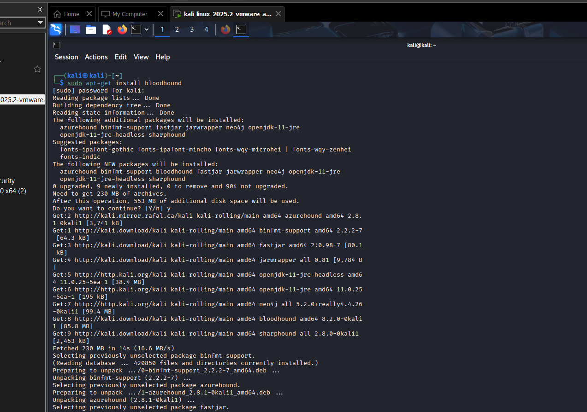
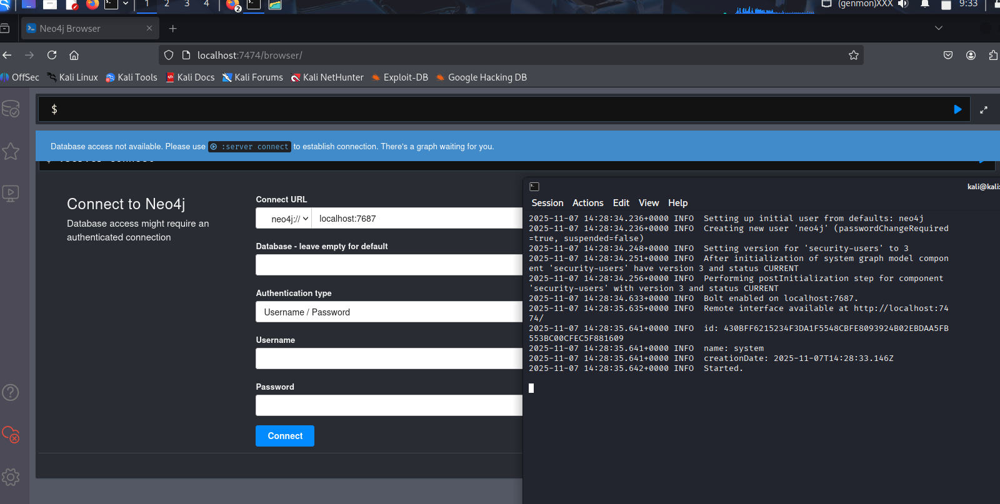
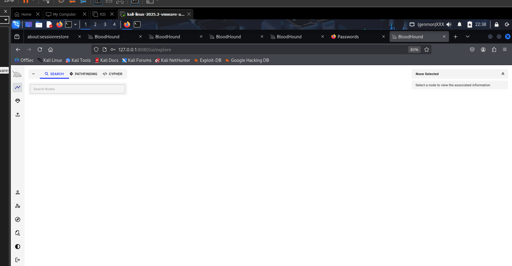
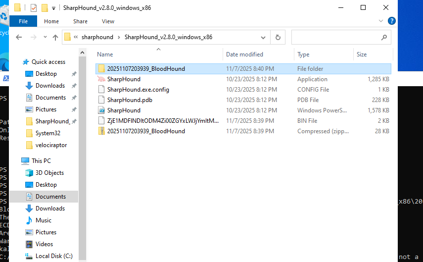
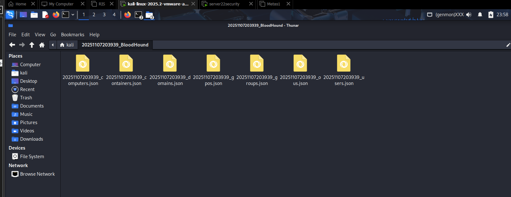
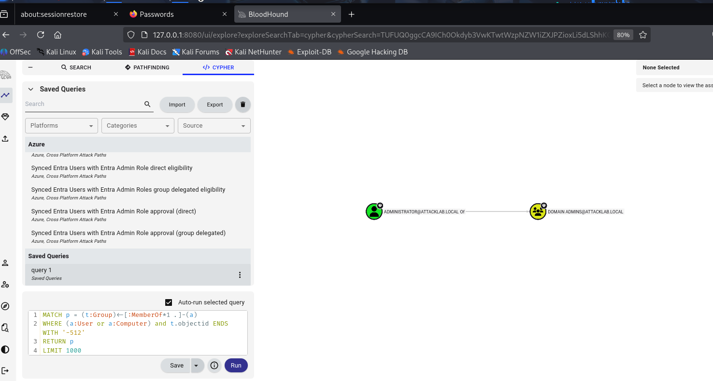
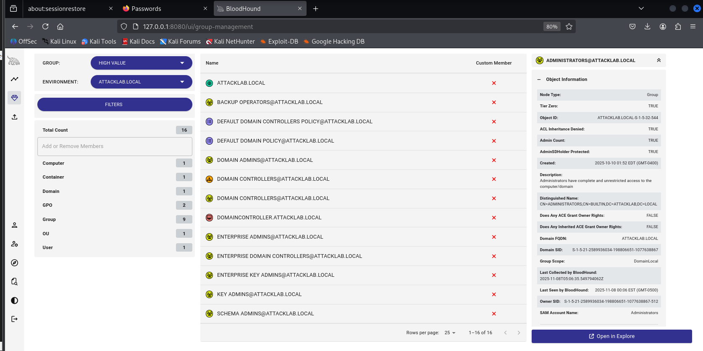
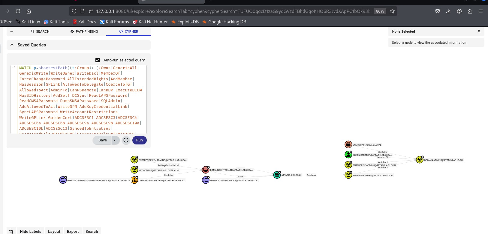
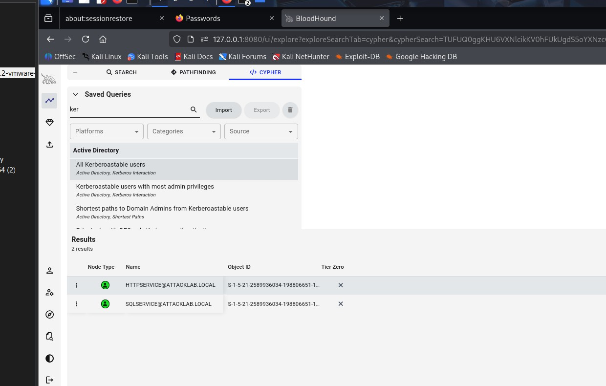
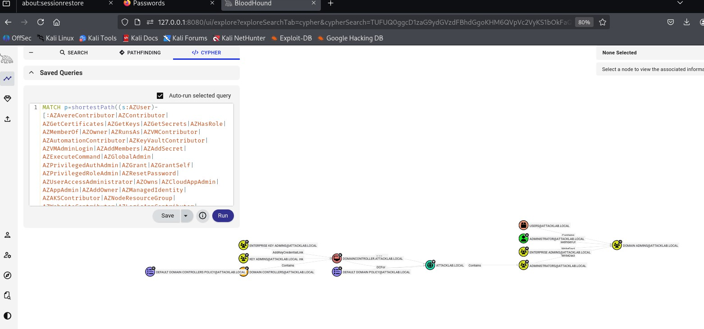

# Lab 5 — Active Directory Attack Path Detection with BloodHound

**Installation of Bloodhound:** Bloodhound is a open source tool that helps analyze and visualize relationships in Active Directory environments. We are going to install bloodhound on kali and we will be configuring that on kali. Then we will try to find attack paths using Bloodhound.

To install it we will do sudo apt install bloodhound -

Now we need to start Neo4j which is essential for bloodhound. On our terminal we will do sudo neo4j console -

Now here in our webpage we will login with our default credentials which neo4j for both username and password. After login to neo4j page, it will prompt to change the password. 

On the command prompt we will do sudo bloodhound without killing the interface. Now it will take us to bloodhound webpage. Here we will login to our web page with default username and password. For me it was admin admin. Then it will prompt to change the password. After doing so, we will get a blank webpage because no data has  been input yet. 

**Sharphound**

Now that we have bloodhound ready to analyze, we have run Sharphound. This is a type of system file which will compromise windows server and take all the details as a file that we will need to import on bloodhound. To do so we will download sharphound from the github repository and will run it on windows server. 

We can see there is a zip file that was generated after I clicked on SharpHound. It will generate this file. Then I use scp to send this zip file to my kali. On my kali I unzip the file and see there are files that are generated. 

Now we will go to bloodhound and upload these files. After uploading this file we will go to saved query and set a query for our json files. After I saved the query and I can see that my server is connected to Domain Admin@AttackLAB.local. 

**Analysis and Documentation:**

Now that we can access to the domain controller and user of the compromised windows. We can do analysis and can see all the computers,containers,domains,GPOs,groups,OUs, Users of that AD. 

Here it shows all the information about the environment or AD. Now we will run some queries and we will try to find some attack paths.

Now we will find shortest paths to Domain Admins. This is one of the most important BloodHound queries. This queries finds all possible ways that any user, computer,or group in my domain can gain Domain Admin Privileges through various types of relationships and permissions. Now we will run the query from bloodhound-

This query is looking for group membership attacks with nested group with specifying which is Domain Admins. It can lead to ACL-based attacks which will give access to the attackers the followings:
- **`GenericAll`** - Full control over an object
    
- **`GenericWrite`** - Modify object properties
    
- **`WriteOwner`** - Change the owner of an object
    
- **`WriteDACL`** - Modify permissions on an object From the query we can say that 

From our query we can see DOMAINCONTROLLER.ATTACK.LOCAL and USERS@ATTACKLAB.LOCAL has red marked. Which show us they have High-value targets. An attacker can reach the Domain Controller and ultimately the Domain Admins group. Those are high-risk attack paths. Common attack could be-
1. **"User@ATTACKLAB.LOCAL has `ForceChangePassword` on Domain Admin"** → Reset DA password
    
2. **"User ADMINISTRAATOR@ATTACKLAB.LOCAL has `AddMember` on Domain Admins group"** → Add themselves to DA group
    
3. **"Computer Admin → DC Admin"** → Compromise computer, then attack DC

Now I will check all kerberoastable in the query section. we will list all the kerberoastable accounts to find service accounts with crackable passwords. 

This query gives us 2 service accounts that are vulnerable to kerberoasting. They are-  HTTPSERVICE@ATTACKLAB.LOCAL and SQLSERVICE@ATTACKLAB.LOCAL. Now any domain user can request service tickets for these accounts. Attackers can crack the service account passwords offline and they can gain the privileges of these service accounts. This is dangerous because Service accounts often have elevated privileges and if these accounts are in admin groups, you get instant privilege escalation. Now the attack paths will be more vulnerable such as-
scenario1: Regular User → Kerberoast Service Account → Already Domain Admin → Total Compromise
scenario2: Regular User → Kerberoast Service Account → Add self to Domain Admins → Total Compromise

Now we will run Find Shortest Paths to High Value Targets on query section. It will show us the paths to all privileged groups. 

Now from the query we can see-
- `USERS@ATTACKLAB.LOCAL` (container)
    
- `ADMINISTRATOR@ATTACKLAB.LOCAL` (green user) — shown as **member of** `DOMAIN ADMINS@ATTACKLAB.LOCAL` (yellow group).
    
- `ADMINISTRATORS@ATTACKLAB.LOCAL`, `ENTERPRISE ADMINS@ATTACKLAB.LOCAL`, `KEY ADMINS@ATTACKLAB.LOCAL`, `ENTERPRISE KEY ADMINS@ATTACKLAB.LOCAL` (groups).
    
- `DOMAINCONTROLLER.ATTACKLAB.LOCAL` (red computer).
    
- `DEFAULT DOMAIN CONTROLLERS POLICY@ATTACKLAB.LOCAL` and `DEFAULT DOMAIN POLICY@ATTACKLAB.LOCAL` (GPOs).
    
- `ATTACKLAB.LOCAL` — domain object (teal globe).

Attack path1 -  KEY ADMINS (AddKeyCredentialLink)→ DOMAINCONTROLLER.ATTACKLAB.LOCAL

Here, members of the KEY ADMINS group can add key-credentials (msDS-KeyCredentialLink) to the DC computer object. Attacker compromises a low-priv user and uses enumeration (SharpHound) to find KEY ADMINS → DC AddKeyCredentialLink. If attackers got the access to Domain admin and eventually it ca become a Domain Admin. 

Attack path2 - SOME-GROUP —AdminTo→ DOMAINCONTROLLER.ATTACKLAB.LOCAL → DC capabilities → DOMAIN ADMINS (by taking over DC).

Here, the group has administrative control over the DC macgine object. Attacker may obtain membership or credentials for that group → log into DC or run privileged actions → extract secrets, install persistence, perform DCSync → become Domain Admin.